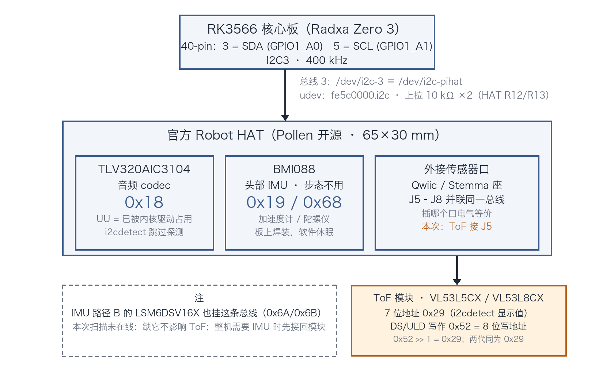
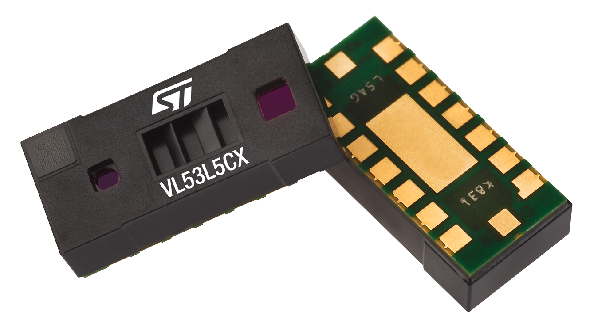
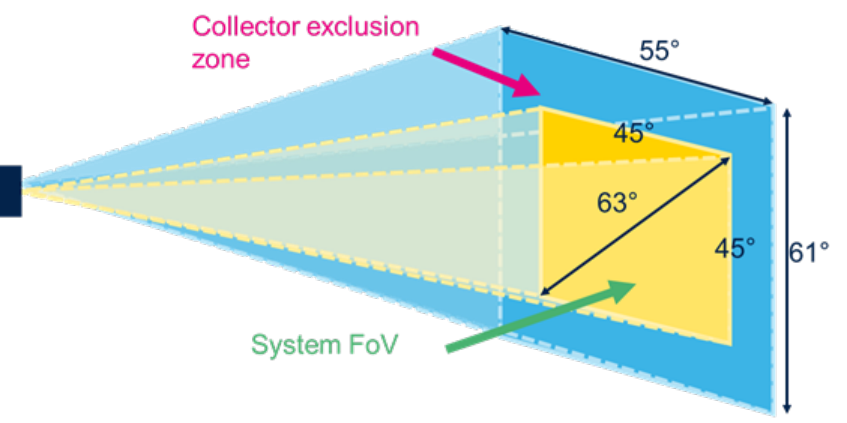
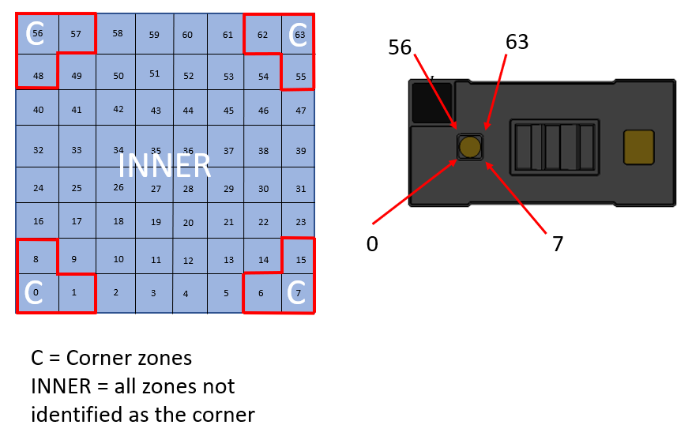
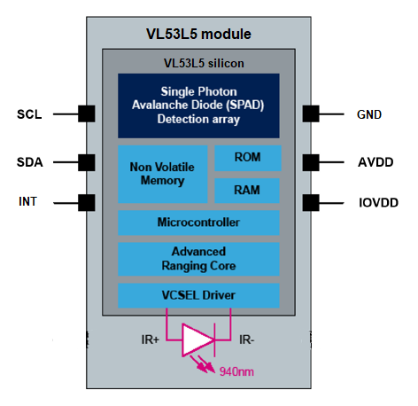
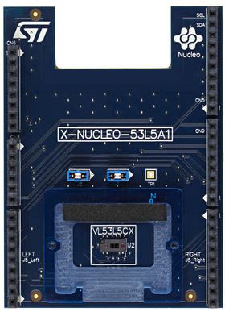

# ToF 集成教程：I²C 识别与 tofd 验收

这份文档回答一个问题：**鸭子的深度数据从哪来，怎么接、怎么在总线上认出它、怎么验收。**

官方 Robot HAT 上没有 ToF——它经 HAT 的 Qwiic/Stemma 座外接，挂在核心板的 I2C3（总线 3）上。
这条总线是全家福式共享的，一次 `i2cdetect` 看到的就是全部：



*图 1：总线 3 挂载全景（本仓绘制；依据：
[硬件规格速查](../microduck-replica/docs/硬件规格速查.md)、[cheatsheet §ToF](robot/cheatsheet.md)、
`scripts/setup-board.sh` 的 `configure_tof()`）。*

## 1. 传感器是谁：VL53L5CX / VL53L8CX 两代同口



*图 2：VL53L5CX 模块本体（来源：ST《VL53L5CX datasheet》封面，工作区 `VL53L5CX资料/vl53l5cx.pdf`）。*

`tofd` 对两代传感器都支持，靠读芯片 ID 自动选驱动，互换不改软件（[cheatsheet §ToF](robot/cheatsheet.md)）。
关键参数全部引自数据手册 `VL53L5CX资料/vl53l5cx.pdf`（ST 官方，38 页，下称 DS）：

| 项 | 值 | 出处 |
|---|---|---|
| 分区 | 4×4 或 8×8；8×8 共 64 zone，编号 0 起始逐行递增 | DS p1；p18 |
| 量程 | 最远 400 cm，每个 zone 独立多目标测距 | DS p1 Features |
| 帧率 | 最高 60 Hz | DS p1 Features |
| FoV | 探测体积 45°×45°（对角 63°）；集光排除区对角 82° | DS p1；p3 Table 2 / Figure 1 |
| 光源 | 940 nm 人眼不可见 VCSEL + SPAD 接收阵列 | DS p1 |
| 模块尺寸 | 6.4 × 3.0 × 1.5 mm | DS p1 |
| I²C | 400 kHz – 1 MHz；默认地址写作 **0x52**（8 位写地址） | DS p3 Table 1 |
| 激光安全 | Class 1 激光标签（IEC 60825-1:2007/2014） | DS p27 Figure 25–27 |



*图 3：System FoV（黄区，45°×45°，对角 63°）与集光排除区（蓝区）（来源：DS Figure 1, p3；
角度数值与 p3 Table 2 一致）。*



*图 4：8×8 模式的 64 个 zone 编号（0 起始，逐行递增），红框为角区（来源：DS p18）。*



*图 5：模块内部框图：SPAD 阵列、测距核、固件 MCU 与 940 nm VCSEL（来源：DS Figure 3, p5）。*

## 2. 0x52 与 0x29 是同一个地址

DS 的 Table 1（p3）和 ULD 驱动头文件写的都是 **0x52**：

> `#define VL53L5CX_DEFAULT_I2C_ADDRESS ((uint16_t)0x52)`
> —— X-CUBE-TOF1 v2.0.0，`Drivers/BSP/Components/vl53l5cx/modules/vl53l5cx_api.h` L79

0x52 是**含读/写位的 8 位地址**；Linux I²C 工具链（`i2cdetect` 等）显示 **7 位地址**，
0x52 右移一位 = **0x29**。DS 写 0x52、`i2cdetect` 见 0x29，说的是同一颗器件。
注意 VL53L8CX 默认地址同为 0x29——**扫描分不出代际**，代际由 `tofd` 的 ID 读回答。

## 3. 实录：ToF 上 J5 后的一次总线扫描（2026-10-13）

操作：断电拔下 HAT 上 J5、J6 的原有连接，把 ToF 模块接到 **J5**，上电后扫描（与
[cheatsheet](robot/cheatsheet.md) 给的标准命令一致）：

```text
$ i2cdetect -y -r 3
     0  1  2  3  4  5  6  7  8  9  a  b  c  d  e  f
00:                         -- -- -- -- -- -- -- --
10: -- -- -- -- -- -- -- -- UU 19 -- -- -- -- -- --
20: -- -- -- -- -- -- -- -- -- 29 -- -- -- -- -- --
30: -- -- -- -- -- -- -- -- -- -- -- -- -- -- -- --
40: -- -- -- -- -- -- -- -- -- -- -- -- -- -- -- --
50: -- -- -- -- -- -- -- -- -- -- -- -- -- -- -- --
60: -- -- -- -- -- -- -- -- 68 -- -- -- -- -- -- --
70: -- -- -- -- -- -- -- --
```

**0x29 在列——ToF 的电气连接一次到位。** 四个地址逐一判读：

| 扫描值 | 器件 | 判读 |
|---|---|---|
| `0x18 UU` | TLV320AIC3104 音频 codec | `UU` = 已被内核驱动认领（HAT overlay 绑定），i2cdetect 跳过探测。HAT 自带，永远在，正常 |
| `0x19` | BMI088 加速度计 | HAT 板载，步态不用的休眠器件（"dormant"）。HAT 自带，正常 |
| **`0x29`** | **ToF（VL53L5CX / VL53L8CX）** | 本次接 J5 的模块在应答——**接对了** |
| `0x68` | BMI088 陀螺仪 | 同 0x19，HAT 自带 |
| （未见 0x6a/0x6b） | LSM6DSV16X（IMU 路径 B） | 扫描时**不在总线上**。缺它不影响 ToF；整机要开运动前按 [IMU 集成教程](IMU集成教程-I2C直读与imu_to_dxl.md)接回 |

判读用到的两条背景知识：

- **J5–J8 四个 Qwiic 座并联在同一总线**（[官方 HAT 解读](deep-dive/42-官方HAT解读.md)）：
  插哪个口电气等价，拔掉 J6 的原有连接不影响 J5 上的新器件。
- **`UU` 不是故障**：内核认领的地址 i2cdetect 不再探测，直接标 `UU`。0x18 由音频
  overlay（`aic3104-i2c3`）绑定，属于"看到 UU 才说明音频驱动正常挂上了"。

## 4. 软件验收：从 0x29 到 8×8 出帧

地址在线只证明电气通了，ToF 的验收以 `tofd` 出帧为准。`tofd` 独占这颗传感器
（别的进程不读它；同一条总线上 robotd 只读 IMU）：

```bash
sudo i2cdetect -y -r 3   # 总线 3 即 /dev/i2c-pihat（udev 规则由 setup-board.sh 配置）
robotctl monitor         # 然后按 t：8×8 深度网格
journalctl -u tofd -b
```

`monitor` 的 ToF 块长这样（示例输出，引自 cheatsheet）：

```text
┌ tof VL53L8CX · 15 Hz · 8×8 · 48/64 ranged · 0.12–3.54 m ─────────────┐
│ 0.12 0.15    x 1.44 1.86    · 2.70 3.12                              │
└ · nothing in range · x could not measure · near→far ── seq 412 · 6 ms ┘
```

块头会直接报出芯片代际（上例 VL53L8CX）——这就是上面说的 ID 读。块的三种状态对应三种修法：

| monitor 显示 | 含义 |
|---|---|
| `connecting to tofd…` / `no depth stream` | tofd 没在跑：`systemctl status tofd` |
| `no sensor: …` | tofd 活着，总线上无应答：回 §3 扫 0x29 |
| `waiting for the first frame…` | 已在测距，首帧约 66 ms 后到（15 Hz 一帧） |

网格里的 `x` 是"这个 zone 没测出来"，`·` 是"测了、范围内没东西"——大片 `x` 不等于传感器坏。
`sudo systemctl stop tofd` 随时可停，没有别的守护进程依赖它。要把深度变成可玩的东西
（对着它"吹"出音符的 theremin），机制见 [cheatsheet §theremin](robot/cheatsheet.md)。

## 5. 误区与红线

1. **看见 0x29 ≠ 装的是 VL53L5CX**：L8CX 同址，代际看 monitor 块头或 tofd 日志的 ID 读。
2. **看见 BMI088（0x19/0x68）≠ 步态 IMU 通过**：控制闭环的姿态来自 LSM6DSV16X
   （`imu_to_dxl` 板，ID 200 / I²C 0x6A·0x6B），与这颗板载 IMU 互不能替代。
3. **严禁增大激光功率或外加聚光光学**：DS p27 明文约束（Class 1 标签的前提就是不动它）。
4. **加盖片/开窗口先读资料**：DS 的直方图串扰补偿覆盖不了任意开窗；工作区
   `VL53L5CX盖片资料.pdf` 是配套 940 nm 盖片的实测规格（穿透率 >92%、串扰抑制），自开窗口按它选材。

## 6. 故障速查

| 现象 | 先查 |
|---|---|
| 扫描里没有 0x29 | Qwiic 线序与供电（3.3V/GND）；四个口并联，把模块换到 J6–J8 任一口再扫，可排除单个座子问题 |
| 连 0x18 的 `UU` 都没有 | 整条总线没起来：HAT 是否插好、i2c3 overlay 是否加载（`ls -l /dev/i2c-*`；总线本身由 `setup-board.sh` 音频段开通） |
| monitor 显示 `no depth stream` | tofd 没跑：`systemctl status tofd`、`journalctl -u tofd -b` |
| monitor 显示 `no sensor` | tofd 活着但无应答：重扫 0x29，查供电 |
| 网格大片 `x` | 不是坏：见 §4 的 `x` / `·` 之别 |
| 想确认代际 | i2cdetect 无能为力（同为 0x29）：看 monitor 块头或 tofd 日志 |
| 拔了 J6 后少了别的器件 | 正常：J5–J8 并联，拔哪个口只影响插在那个口上的东西；0x18/0x19/0x68 在 HAT 板上，不受影响 |

## 7. 本地资料清单

以下文件在工作区 `VL53L5CX资料/`（本地资料，未入库）：

| 文件 | 是什么 |
|---|---|
| `vl53l5cx.pdf` | ST 官方数据手册（38 页）——本文全部参数与页码出处 |
| `VL53L5CX盖片资料.pdf` | 第三方配套盖片规格（IR-DF031）：940 nm 穿透率 >92%、防尘防串扰 |
| `VL53L5CX测试例程STM32F4 en.X-CUBE-TOF1_v2.0.0.zip` | ST 官方例程包 + ULD 驱动源码（默认地址定义在 `vl53l5cx_api.h`，即 §2 引文） |



*图 6：ST 官方评估板 X-NUCLEO-53L5A1（例程包对应硬件）。装机走的是裸模块 + Qwiic 转 Stemma
接 J5，不是这块板，图仅作器件识别参照（来源：X-CUBE-TOF1 v2.0.0 `_htmresc/`）。*

## 8. 文档地图

| 想深入哪块 | 去读 |
|---|---|
| tofd 的运行时操作与 monitor 网格 | [cheatsheet §ToF](robot/cheatsheet.md)（该机制归属页） |
| tofd 的功耗账、头部 IMU 开关 | `docs/project/tof-on-demand.md` |
| HAT 的 Qwiic 座、codec、BMI088 | [官方 HAT 解读](deep-dive/42-官方HAT解读.md) |
| 同一条总线上的另一颗传感器（IMU） | [IMU 集成教程](IMU集成教程-I2C直读与imu_to_dxl.md) |
| 硬件地址总表（codec/BMI088/ToF） | [硬件规格速查](../microduck-replica/docs/硬件规格速查.md) |

---

*本教程的口径：0x29 在线只证明电气与地址对上了，ToF 验收以 tofd 出帧为准；0x18/0x19/0x68
是 HAT 自带器件，与拔插 J5/J6 无关；i2cdetect 分不出 VL53L5CX/VL53L8CX，代际以 tofd 的 ID 读为准。*
