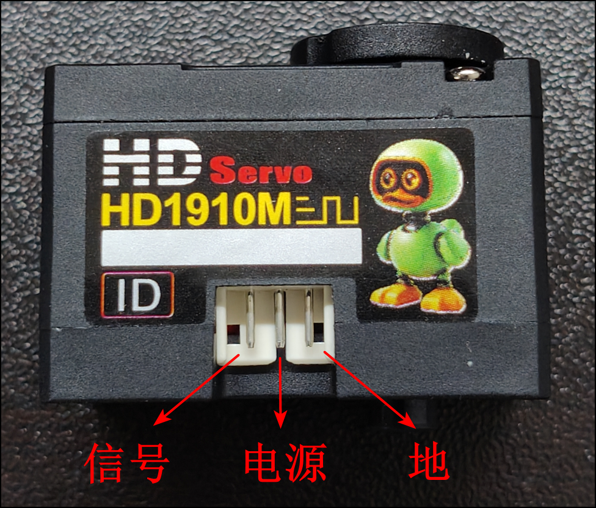

# URT2 + HD-1910-C001 接线、组装与测试指南

这份文档面向第一次接触电路和总线舵机的人，是[URT2 + HL-2915 指南](URT2-HL2915接线组装与测试指南.md)的
装机主线版本。HL-2915 路线负责把协议、供电、辨识、重训在 12 V 开发单元上走通；当前 15 只
装机舵机是 HD-1910-C001。两者插头外形相近、帧格式同族，但**电压窗、线序、默认模式和寄存器
地址都不同**——不能把 2915 的接线表和内存表直接搬过来。

目标不是让整机立即行走，而是安全完成：

```text
认识接口
  → 验证 7.4 V 电源
  → 单只舵机只读通信
  → 单只小角度运动
  → 第二只改 ID
  → 两只同时只读（摇晃法）
  → 设置机械中位
  → 安装一个测试关节
  → （装机后）15 只只读巡检
```

每完成一步，就把结果和证据记入
[HD1910 标定记录模板](../microduck-replica/docs/HD1910标定记录模板.csv)和构建日志。
上一步没有通过，不进入下一步。

## 1. 型号口径先钉死

| 名称 | 指什么 |
|---|---|
| **HD-1910-C001** | 本文的对象，也是当前 15 只装机实物。规格依据随货《HD-1910-C001 串型规格书》A/0（2026-09-07 初次发行）与 HD-1910M-C001 尺寸图（2026-09-02），均已入库：`OpenMicroDuck/hardware_spec/servo/` |
| HLS1910 | XGODUCK 对同系列舵机的叫法；其 BAM JSON 内部 actuator 字段甚至还是 `sts3215`——数值可当先验，身份不能认 |
| HL-1910 | 2026-09-07 采购记录里的写法（[解读 51](deep-dive/51-HL1910尺寸链.md)、[解读 84](deep-dive/84-案例复盘HL1910到HL2915.md)记下了这次口径差）；复刻工作台《称重与标定模板-HD1910》已把实货口径定为 HD-1910-C001 |
| HL-2915-C001 | 12 V 开发单元，另一条已走通的路线，不是本文对象 |

规格书对这颗舵机的完整叫法是：HD1910M，6 V/12 kg·cm 级 TTL 串口舵机——塑胶壳
（PA66+GF43%）、空心杯电机、金属齿、360° 磁编码、双轴出力、带力控。

## 2. 与 HL-2915 的关键差异（接线前必读）

| 项目 | HL-2915-C001（开发单元） | HD-1910-C001（装机主线） |
|---|---|---|
| 工作电压 | 9–14 V，典型 12 V | **4–8.4 V**，典型 4.8/6/7.4 V |
| 插头 | PH1.25-3P | **AMP2.0-3P**，线长 15±0.5 cm |
| 线序 | 1=GND，2=Vcc，3=Signal | **1=Signal，2=Vcc，3=GND（相反）** |
| 线色 | 可按颜色区分 | **三根全是黑色，只能按功能核对，不能按颜色猜** |
| 出厂默认模式 | 模式 0（角度伺服） | **模式 4（纯位置 PD，面向 Sim2Real）** |
| 出厂默认保护 | 过载/过压/过热 | **过流、过压默认关闭**；仅过热（>80 °C 断扭矩）默认开启 |
| 重量 | 27.8 ± 2 g | 21 ± 2 g |
| 出力轴螺丝 | M2.5×3.5 | M2.5×6 |
| 出力轴 | 25T，外径 4.95 mm | 25T，外径 4.95 mm（舵盘同规格） |
| 齿轮虚位 | ≤1° | ≤0.5° |
| 电机 | 有芯（Core） | 空心杯（Coreless） |

接口与协议的相同点：ID 0–253（出厂默认 1）、波特率 38400 bps–1 Mbps（出厂默认 1 Mbps）、
半双工异步串口 8N1、0–4095 对应 360°、中位 2048、分辨率 0.088°/步、信号高电平 2–5 V、
最高位置更新率 1 kHz、反馈包含位置/速度/电流/电压/温度。

一个容易踩的坑：HL-2915 教程里的"电压窗寄存器 14/15/28"属于 HL 的磁编码内存表。
HD-1910 的寄存器布局不同（见 §6），同一类参数地址完全不同，**寄存器操作以本文 §6
和随货内存表为准**。

## 3. 电源应该买多大

HD-1910-C001 官方参数（±10%）：空载速度 73/92/113 RPM、堵转扭矩 9/12/15 kg·cm、
堵转电流 1.2/1.6/2 A（分别对应 4.8/6/7.4 V）；空载电流 ≤160/180/210 mA；额定负载
2.2/3/3.7 kg·cm，额定电流 500/690/900 mA。

台架推荐用可限流直流电源设 **7.4 V**（2S 标称）。2S 满电 8.4 V 恰好等于规格书上限、
零余量，充电后直接上台架前先量一次开路电压；不要用 3S。

| 场景 | 电源建议 | 初始限流 |
|---|---|---|
| 一只，只读/PING | 7.4 V/2 A 可限流电源 | 约 0.5 A |
| 一只，悬空小角度运动 | 7.4 V/2 A 可限流电源 | 约 1.0 A |
| 两只，同时只读 | 7.4 V/2 A 可限流电源 | 约 1.0 A |
| 两只，悬空小角度运动 | 7.4 V/3 A 可限流电源 | 先约 2.0 A |

**为什么限流是唯一硬保护**：HD-1910 出厂时过流（>0.5 A 持续 2 s）和过压（>10 V 或 <4 V）
保护都是**默认关闭**的，只有过热保护默认开启。台架阶段不要打开它们，也不要依赖它们——
电源限流 + 小步动作 + 随手断电才是保护。首次台架不做堵转测试，不用手抓输出轴试扭矩，
不要使用面包板承载舵机电流。

## 4. 认识 URT2 和线序

URT2 的认识与通用操作（USB-C、TTL-Bus、TTL 侧 G/V1 端子、3V3/5V 开关置 `5V`、
RS485/V2 本项目不用）与 HL-2915 指南 §3 完全一致，不在此重复。

差别只在舵机这一端。HD-1910 使用三根线，插头是 AMP2.0-3P：

```text
1 = Signal（TTL 串口信号）
2 = Vcc（供电正极）
3 = GND（供电负极/信号地）
```

**方向参照（实机确认）**：面向标签面（贴纸朝你），从左到右就是 1/2/3 脚——**信号、电源、地**。
从背面或线缆另一侧看，左右正好镜像，按"左=信号"去接就反了；所以转接线始终按功能核对，
不按左右位置，也不按线色（三根全是黑色）。标签自带 ID 手写框，验收通过后把分配的 ID 写上去。



URT2 和舵机的插头尺寸可能不同。不能硬插，也不能按线色猜线序（三根全是黑色）；
只按 `Signal/Vcc/GND` 功能制作或核对转接线。做好的转接线贴标签：`HD1910 专用，与 HL 线序相反`。

## 5. 总接线图

```text
                         USB-C 数据线
电脑 ──────────────────────────────► URT2
                                      │
7.4 V 电源正极 ─────────────────────► V1（TTL 侧）
7.4 V 电源负极 ─────────────────────► G （TTL 侧）
                                      │
                               URT2 TTL-Bus
                               ┌────────────┐
                               │ G  V1  S   │
                               └─┬──┬───┬───┘
                                 │  │   │
                                 │  │   └────► 舵机 1 脚 Signal
                                 │  └────────► 舵机 2 脚 Vcc
                                 └───────────► 舵机 3 脚 GND
```

注意和 HL-2915 的接法逐脚相反：S 接 1 脚（不是 3 脚），G 接 3 脚（不是 1 脚）。

绝对不要：

- 把 7.4 V 以上（尤其 12 V）接到 HD-1910——超过 10 V 触发过压条件，且出厂过压保护默认关闭；
- 把 7.4 V 接到 USB、UART 排针的 5V/3V3；
- 把 HD-1910 接到 RS485 的 A/B/V2；
- 用 Radxa、树莓派或 ESP32 的 5 V 给舵机供电；
- 带电插拔舵机线；
- 同时接入两只仍为出厂 ID=1 的舵机。

## Task HD1910-001：验证电源和 URT2 端子

Goal：在不连接舵机时确认 7.4 V 电压和极性。

Files：无。

Action：

1. 关闭电源，拔掉 URT2 USB；
2. 电源正极接 URT2 TTL 侧 `V1`，负极接 `G`；
3. 检查没有裸铜丝碰到相邻端子；
4. 电源设为 `7.4 V`，限流约 `0.5 A`；
5. 打开电源，万用表黑表笔接 `G`，红表笔接 `V1`。

Why：先排除最危险的反接和错端子，再让舵机进入电路。

Verification：万用表显示正的约 `7.4 V`，不能显示 `-7.4 V`。

Expected result：记录照片，然后关闭电源。

## Task HD1910-002：连接第一只裸舵机

Goal：建立只有一只舵机的安全桌面台架。

Files：本文 §4 线序。

Action：

1. 把第一只舵机标记为 `A`；
2. 拆掉舵盘、连杆、支架和打印件；
3. 保持 7.4 V 和 USB 都断开；
4. 将 URT2 `S/V1/G` 分别接到舵机 `1=Signal、2=Vcc、3=GND`，逐根口述复核
   （方向参照 §4 实拍图：面向标签，左=信号、中=电源、右=地）；
5. 把第二只舵机留在桌外，不连接；
6. 把舵机放在非导电表面，输出轴四周不放线缆。

Why：新舵机通常都是 ID=1，两只一起接会同时应答，造成通信冲突；线序按功能核对是因为
HD-1910 与 HL 线序相反且线色不可辨。

Verification：逐根口述并复核 `S→1、V1→2、G→3`。

Expected result：一只无负载舵机连接到 TTL-Bus。

## Task HD1910-003：找出电脑串口号

Goal：只验证 URT2 USB 通信，不给舵机上电。

完整步骤（PowerShell `Get-PnpDevice`、拔插确认 COMx、CH343P 驱动检查）见
[URT2 + HL-2915 指南 Task URT2-003](URT2-HL2915接线组装与测试指南.md#task-urt2-003先找出-windows-com-口)。
macOS 用 URT2/FE-URT-1 走 Python SDK 的路线见
[macOS 舵机调试与图纸查看指南](macOS舵机调试与图纸查看指南.md)。

Verification：出现一个随拔插消失/出现的串口（Windows 如 `COM5`，macOS/Linux 如
`/dev/ttyUSB0`），记下来。

## Task HD1910-004：第一次上电和 FD 只读

Goal：让官方上位机找到一只舵机，但不让它运动。

Files：[飞特软件下载页](https://www.feetech.cn/software.html)。

Action：

1. 确认舵盘和结构件已经拆除；
2. USB 已连接，串口号正常；
3. 打开 7.4 V 电源，观察是否立即进入 0.5 A 限流；
4. 正常后打开 FD，选择实际串口，波特率选 `1000000`，点"打开"→"搜索"；
5. 搜到舵机后点击型号使其高亮；
6. 记录**型号、ID、运行模式、当前位置、电压、温度、电流**，保存参数截图。

Why：官方软件先通，才能证明链路本身成立，再谈仓库自己的驱动。

Verification：只出现一只舵机，预计 ID=1；电压约 7.4 V，温度接近环境温度，参数能刷新。
**运行模式显示 4（纯位置 PD）是这颗舵机的出厂默认，不是故障**——不要"顺手"改回模式 0，
模式与 EEPROM 写入留给标定阶段。

Expected result：A 舵机完成 FD 只读通信。

第一次不要执行恢复出厂、固件升级、一键中位、批量写参数、自动运动或把位置滑杆拖到两端；
也不要尝试模式 1–3（恒速/恒流/PWM 开环）——台架只验证出厂默认的位置模式。

## Task HD1910-005：用仓库探针复核

Goal：证明本仓库的软件可以读取这只舵机。

Files：[hd1910_readonly.py](../microduck-replica/rl-series/scripts/hd1910_readonly.py)（依赖 `pyserial`）。

Action：

1. 完全关闭 FD，让它释放串口；
2. 运行只读巡检（`--ids 1` 是台架单只的写法；脚本默认扫描整机的 15 个 ID）：

```bash
python3 microduck-replica/rl-series/scripts/hd1910_readonly.py \
  --port /dev/ttyUSB0 --ids 1
```

3. Windows 下把 `--port` 换成 `COM5` 这类实际串口号；
4. 保存完整输出到 artifacts 并归档。

Why：FD 成功只证明官方软件能通信；探针成功才证明仓库的协议实现（飞特 SCS v1 帧、
HD-1910 寄存器表、半双工链路）也成立。

Verification：`ID 1` 行 `PING ✓`，位置（raw/°）、电压（V）、温度（°C）、电流（raw）都有
合理读数；电压应约 `7.4`（寄存器 62，0.1 V/LSB）。

Expected result：A 舵机保持 ID=1，贴上 `A / ID=1` 标签。

## Task HD1910-006：第一次小角度运动

Goal：在没有机械负载时验证低速、小角度动作。

Files：FD。

Action：

1. 输出轴仍然不安装舵盘；
2. 电源保持 7.4 V，将限流提高到约 `1.0 A`；
3. 在 FD 中读取当前位置；
4. 设置低速度，从当前位置增加约 50 个计数，再减少约 50 个计数；
5. 50 个计数约等于 4.4°（0.088°/步）；
6. 测试结束后关闭扭矩、关闭电源。

Why：第一次直接命令到 0、2048 或 4095，可能造成突然的大角度运动。HD-1910 默认的
纯位置 PD 模式响应特性与 HL-2915 的模式 0 不同，先用低速小步建立手感。

Verification：动作平稳，没有撞击、持续抖动、异响、掉线或快速升温；停止后电流明显回落
（空闲电流约 20 mA 量级）。

Expected result：A 舵机完成无负载小角度测试。

出现焦味、冒烟、线缆发热、电流持续顶到限流值或 USB 反复掉线时，立即关闭电源。

## Task HD1910-007：把第二只改成 ID=2

Goal：让两只舵机具有唯一 ID。

Files：FD。

Action：

1. 关闭电源，拔掉 A，只接第二只 B；
2. 上电后在 FD 中确认 B 响应 ID=1；
3. 用 FD 的写参数功能把 B 的 ID 改为 `2`；
4. 关闭电源，等待几秒后重新上电；
5. 用探针按新 ID 验证：

```bash
python3 microduck-replica/rl-series/scripts/hd1910_readonly.py \
  --port /dev/ttyUSB0 --ids 2
```

Why：总线上相同 ID 的设备会同时应答。

Verification：探针输出 `ID 2` 行 `PING ✓`。

Expected result：贴标签 `B / ID=2`。ID 1/2 只是台架编号，装入整机前还要按 §7 的
官方关节表重新分配。

## Task HD1910-008：两只同时只读（摇晃法）

Goal：验证两只舵机能共享一条 TTL 总线，并且位置反馈跟手。

Files：[hd1910_readonly.py](../microduck-replica/rl-series/scripts/hd1910_readonly.py)。

Action：

1. 关闭电源，同时接入 A 和 B，电源限流先约 `1.0 A`；
2. 先执行一次单次巡检：`--ids 1,2`；
3. 再进入 60 秒循环观察（摇晃法）：

```bash
python3 microduck-replica/rl-series/scripts/hd1910_readonly.py \
  --port /dev/ttyUSB0 --ids 1,2 --watch 60
```

4. 观察期间用手缓慢扳动每只舵机的输出轴几度，看位置列是否跟手变化。

Why：先验证供电、ID 和总线稳定，再考虑安装结构。摇晃法用"扳关节看位置"验证
反馈链路，不需要给扭矩。

Verification：两只都 `PING ✓`，扳动时位置连续变化、松手后稳定，无自行运动，温度不持续上升。

Expected result：两只台架通信通过，证据截图入档。

## Task HD1910-009：设置机械中位并安装一个测试关节

Goal：把编码器中位和结构零位对齐。

Files：打印件、对应 CAD/装配图、[HD1910 标定记录模板](../microduck-replica/docs/HD1910标定记录模板.csv)。

Action：

1. 再次只接一只已经通过测试的舵机；
2. 保持舵盘和结构件拆除，在 FD 中设低速度，缓慢移动到位置 `2048`；
3. 关闭扭矩和电源，不要用手强拧输出轴；
4. 把舵盘安装在最接近结构零位的齿位；
5. 先松装舵机和支架，检查壳体方向、输出轴线和出线方向（HD-1910 是双轴出力，先确认
   这一侧是不是结构需要的那一侧）；
6. 给线缆留活动余量，确认全行程不会夹线；
7. 用 M2.5×6 螺丝对角逐步拧紧，不把塑料外壳（PA66+GF43%）拧变形；
8. 重新上电，从结构零位附近 `±5°`、`±10°` 逐级测试；
9. 把实际零位（`zero_raw`）、方向（`direction`）和安全限位（`min_raw/max_raw`）写入
   HD1910 标定记录模板对应行。

Why：先装结构再找中位，容易撞限位、夹手或让舵机堵转。

Verification：结构无干涉、不夹线、无明显变形；小角度动作方向正确且电流、温度正常。

Expected result：完成一个关节台架，标定模板对应行填写完毕。只有两只舵机时不能组装和
运行完整 15 关节机器人。

## Task HD1910-010：装机后的 15 只只读巡检（整机阶段）

Goal：15 只 HD-1910 装入鸭体后，在给扭矩之前完成一次全总线只读验收。

Files：[hd1910_readonly.py](../microduck-replica/rl-series/scripts/hd1910_readonly.py)、
[hd1910_reboot.py](../microduck-replica/rl-series/scripts/hd1910_reboot.py)、
[hd1910_rawdebug.py](../microduck-replica/rl-series/scripts/hd1910_rawdebug.py)、
[hd1910_signaltest.py](../microduck-replica/rl-series/scripts/hd1910_signaltest.py)。

Action：

1. 机器人放在吊架或支架上，输出轴不承担载荷；
2. 停掉占用整机串口的守护进程，巡检完再恢复：

```bash
sudo systemctl stop robotd
python3 microduck-replica/rl-series/scripts/hd1910_readonly.py            # 默认 /dev/ttyS2、15 个官方 ID
sudo systemctl start robotd
```

3. 逐只核对 §7 的官方 ID：哪一只不在预期位置，停下来查机械装配，不要急着改 ID；
4. 做一次摇晃法全表巡检（`--watch 60`），扳动每个关节看位置是否跟手；
5. 某只零响应时，先跑 REBOOT 清锁再下结论（HL-2915 台架上验证过的教训：零响应≠坏）：

```bash
sudo systemctl stop robotd
python3 microduck-replica/rl-series/scripts/hd1910_reboot.py /dev/ttyS2 13,22   # 换成实际 ID
sudo systemctl start robotd
```

Why：装机后最贵的错误是"按坏件处理了一只好舵机"或"给没验收的总线上了扭矩"。

Verification：`15/15 应答`；每只 ID 与安装位置一致；摇晃法位置跟手；电压、温度正常。

Expected result：整机只读验收通过，可以进入
[HD1910 标定记录模板](../microduck-replica/docs/HD1910标定记录模板.csv)的逐关目标定与
[kissqy 适配的标定门控](../Microduck-kissqy/microduck-hd1910/firmware/config/hd1910-calibration.template.toml)。

## 6. 帧格式与寄存器速查

协议是飞特 SCS v1 半双工帧（与经典 SCS 族同帧格式，寄存器表不通用）：

```text
FF FF id len inst params ~sum     len = 参数数 + 2，~sum = 取反和
PING  inst=0x01（无参数）
READ  inst=0x02，参数 = [起始地址, 长度]
REBOOT inst=0x08（清锁，不写任何寄存器）
台架/整机均为 1 Mbps、8N1
```

下表来自 kissqy HD1910 适配
（`Microduck-kissqy/microduck-hd1910/firmware/duck-control/src/hd1910.rs`）和
`microduck-replica/rl-series/scripts/hd1910_readonly.py`，与 HL-2915 磁编码内存表不可互套；
最终以随货内存表为准。

| 地址 | 内容 | 说明 |
|---|---|---|
| 21–23 | EEPROM P/D/I | 上电默认增益（快照用，不随便写） |
| 33 | 运行模式 | 出厂默认 4（纯位置 PD） |
| 41 | 加速度 | 适配代码**从不写入**，保持出厂值 |
| 42–47 | 目标块（6 字节） | 42–43 目标位置、44–45 目标电流、46–47 目标速度；HD1910 目标速度恒写 0 |
| 48–49 | 扭矩限制 | 16 位小端 |
| 50–51 | 临时 P/D 增益 | 写前先存回滚数据、写后回读校验、卸力才允许写（适配代码的纪律） |
| 56–57 | 当前位置 | 符号-幅值编码：bit15 为符号，0–4095 单圈 |
| 58–59 | 当前速度 | 符号-幅值；50 编码步/秒每计数 |
| 62 | 输入电压 | 0.1 V/LSB，读数除以 10 |
| 63 | 温度 | °C |
| 69–70 | 电流 | 符号-幅值，原始计数；换算 mA 需要按实物标定 |

## 7. 官方关节 ID 对照表

下表是项目的官方 ID 映射（来源同 §8 的标定门控配置）。它是**装配对照**：写 ID 前
必须单只 PING 确认手里这只当前的实际 ID，不能假设。

| ID | 关节 | 区域 |
|---|---|---|
| 10 / 11 / 12 / 13 / 14 | 右髋偏航 / 右髋侧摆 / 右髋俯仰 / 右膝 / 右踝 | 右腿 |
| 20 / 21 / 22 / 23 / 24 | 左髋偏航 / 左髋侧摆 / 左髋俯仰 / 左膝 / 左踝 | 左腿 |
| 30 / 31 / 32 / 33 / 34 | 颈俯仰 / 头俯仰 / 头偏航 / 头侧摆 / 嘴 | 头颈 |

装配配对提醒（来自 Microduck Studio 舵机编号 3D 对照）：大腿同板配对是右侧 12/13、
左侧 22/23；11/21 靠躯干负责侧摆，12/22 在大腿负责俯仰，不要互换。

## 8. 标定门控与下一步

台架通过只是入场券。进入运动前的门控（与 kissqy 适配的
[hd1910-calibration.template.toml](../Microduck-kissqy/microduck-hd1910/firmware/config/hd1910-calibration.template.toml)
一致）：

- `motion_enabled = false`，直到 15 个关节全部 `calibrated` 且带实测 `min_rad/max_rad`；
- `imu_mount_verified = false`：IMU 安装姿态与方向需单独核验，传感器到躯干的旋转
  官方约定为绕 Y +90°；
- 电流寄存器换算（`current_ma_per_count`）必须用实物标定后才能上报 mA；
- 无启动扭矩、无自动运动：给扭矩的每一步都要有刚填过的标定记录作为依据。

三层标定（模型保真 → BAM 标定 → XL330 对齐）的红线和模板见
[称重与标定模板-HD1910](../microduck-replica/docs/称重与标定模板-HD1910.md)；
kissqy 路线装机阶段（HAT 接线、上电 ID 核对、中控关节标定）的操作清单见
[1910-HAT接线与标定清单](1910-HAT接线与标定清单.md)；
用社区 hls_servo_debugger 网页调试器逐颗标定的部署与工作流见
[microduck-community-kit 使用教程](microduck-community-kit使用教程.md)；
IMU 安装方向核验（`imu_mount_verified` 五阶段）见
[IMU 集成教程](IMU集成教程-I2C直读与imu_to_dxl.md)；
仿真侧的参数迁移与 PPO 训练见
[HD1910 仿真迁移与 PPO 训练教程](HD1910仿真迁移与PPO训练教程.md)；
PD 阶跃采集与辨识数据的要求见
[换舵机重训全流程 §2.3](../microduck-replica/docs/换舵机重训全流程.md)。

## 9. 常见故障速查

| 现象 | 先断电后检查 |
|---|---|
| 探针输出"零字节" | 无电、断线、**线序反（三根全黑，按功能核对 S→1/V1→2/G→3）**、串口号不对 |
| 探针输出乱码 | 波特率不是 1 Mbps、共地缺失、两只同 ID 冲突；用 `hd1910_rawdebug.py` 区分 |
| FD 搜不到但探针能读到 | FD 与 Python 探针互斥占用串口，完全关闭一个再开另一个 |
| 昨天还好，今天零响应 | 先 `hd1910_reboot.py` 清锁再判定；不要直接判坏 |
| 一动就顶限流 | 结构干涉、输出轴受阻；立即断电，排查机械 |
| 电压读数×10 不对 | 寄存器 62 是 0.1 V/LSB，除以 10 |
| 位置符号与预期相反 | 56–57 是符号-幅值编码（bit15 符号位）；装机后方向由标定模板 `direction` 处理 |
| 模式显示 4 | 出厂默认纯位置 PD 模式，不是故障；不要在台架改模式 |
| 全新舵机 1 Mbps 搜不到 | 规格书默认 1 Mbps；怀疑出厂参数不同时降波特率对照（从 57600 起试），通了先读快照再改参数 |

## 10. 进入下一阶段的通过条件

必须全部满足：

- [ ] 万用表确认 V1 对 G 为正的约 7.4 V；
- [ ] A 单只响应 ID=1（PING + 位置/电压/温度/电流遥测）；
- [ ] B 单只响应 ID=2；
- [ ] 两只同时只读通过，60 秒摇晃法位置跟手；
- [ ] 无负载小角度运动平稳，停止后电流回落；
- [ ] 机械中位、方向和安全限位已写入 HD1910 标定记录模板；
- [ ] 转接线贴了"HD1910 专用，与 HL 线序相反"标签；
- [ ] 照片、探针输出已归档进构建日志。

完成这些以后，下一步才是按官方 ID 表装机、逐关标定，然后走
[HD1910 仿真迁移与 PPO 训练教程](HD1910仿真迁移与PPO训练教程.md)的真机验证部分。
不要在只读验收之前给整机上扭矩，也不要直接把 HL-2915 或 XL330 的策略加载到
HD-1910 上。

---

*本指南的原则和整个项目一致：每一步都有验收，验收不过不前进，所有数据留档。
真正值钱的不是这颗舵机比 HL-2915 便宜，是 15 只装上去之前每一只都被单独验过。*
